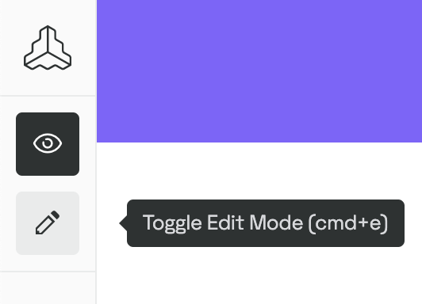
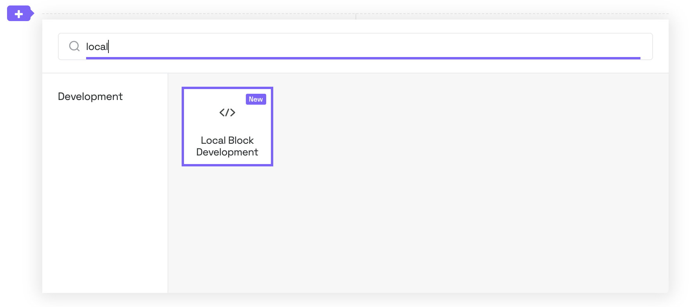

# Guideline Blocks

Conventions, commands and the guide for agents and contributors live in [AGENTS.md](./AGENTS.md); reference
material is in [docs/](./docs/).

## Local block development

### Requirements:

- Node 26
- [pnpm 11](https://pnpm.io/installation)
- Access to a Frontify guideline

### Setup

1. Clone this repository
    ```
    $ git clone git@github.com:Frontify/guideline-blocks.git
    ```
2. Install the dependencies
    ```
    $ pnpm install
    ```
3. Serve a block
    ```
    $ cd packages/<block name>
    $ pnpm serve
    ```
4. Go to your Frontify guideline
5. Switch to edit mode
   
6. Click on the plus icon and add a "Local Block Development" block
   
7. Choose port (default is 5600) and click OK

## Releasing

Merging to `main` publishes exactly the blocks that have a release entry in
[`.releases`](./.releases/README.md), and nothing else. No entry, no release.

```sh
cd packages/audio-block && pnpm release   # this block
pnpm release                              # repo root: one changelog, every block
pnpm release:plan                         # preview what the next merge publishes
```

`pnpm release` asks for the changelog text and writes a small file to `.releases`, which you
commit with your change. CI reads it on merge, deploys and publishes each block named, and
deletes the file.

There are no version numbers to bump -- the marketplace assigns its own version per app on
every deploy.
